# 🌱 Projeto - Cidades ESGInteligentes

API REST de **Gestão de Resíduos e Reciclagem** (tema ESG) em **ASP.NET Core 8**, com
pipeline completo de **CI/CD no GitHub Actions**, containerização com **Docker** e
orquestração com **Docker Compose** em dois ambientes: **staging** e **produção**.

> Atividade da **Fase 6 — Navegando pelo mundo DevOps** (FIAP · 2TDS).
> Aluno: **Guilherme Eger Pereira — RM 97069**.
> Base: API C# desenvolvida na Fase 4, adaptada para simular um ambiente de produção real.

A API cadastra pontos de coleta, registra coletas por tipo de resíduo (papel, plástico,
vidro, metal, orgânico e eletrônico) e calcula indicadores (kg por tipo e total geral),
apoiando metas de reciclagem e logística reversa de uma cidade inteligente.

**O que foi adaptado para a Fase 6**

| Melhoria | Por quê |
|---|---|
| `GET /health` (API + banco) | Usado pelo `HEALTHCHECK` do Docker, pelo `docker compose --wait` e pelos smoke tests do pipeline |
| `GET /` com ambiente e versão (commit) | Prova qual build está no ar em cada ambiente |
| `appsettings.Staging.json` / `appsettings.Production.json` | Log e Swagger diferentes por ambiente (Swagger desligado em produção) |
| Segredos só por variável de ambiente | Senhas e chave JWT vêm dos *secrets* do GitHub, nunca do código |
| Retry de conexão com o banco | A API aguenta o SQL Server demorar a subir ou oscilar |
| +2 testes automatizados (9 no total) | Cobrem o health check e o endpoint de versão |

---

## 🐳 Como executar localmente com Docker

**Pré-requisito:** Docker com Docker Compose v2 (Docker Desktop, Colima ou Docker Engine).

```bash
# 1. Clonar o repositório
git clone https://github.com/GuilhermeEger/cidades-esg-inteligentes.git
cd cidades-esg-inteligentes

# 2. Criar o arquivo de variáveis a partir do exemplo
cp .env.example .env

# 3. Construir a imagem e subir API + SQL Server (espera ficarem "healthy")
docker compose up --build -d --wait

# 4. Conferir
docker compose ps
curl http://localhost:8080/health
```

| O quê | Endereço |
|---|---|
| Swagger | http://localhost:8080/swagger |
| Health check | http://localhost:8080/health |
| Ambiente e versão | http://localhost:8080/ |

As migrações do banco (tabelas + 6 tipos de resíduo) são aplicadas automaticamente na
subida. Para testar rotas protegidas: `POST /api/v1/auth/login` com
`{"usuario":"admin","senha":"admin123"}` e use o token no botão **Authorize** do Swagger.

```bash
docker compose logs -f api   # acompanhar os logs
docker compose down          # parar (os dados ficam no volume)
docker compose down -v       # parar e apagar o banco
```

**Rodar os testes sem Docker** (requer .NET 8 SDK): `dotnet test`

**Simular os dois ambientes na sua máquina** (o mesmo comando que o pipeline executa):

```bash
export DB_PASSWORD='Senha@Forte123' JWT_SECRET='uma-chave-com-pelo-menos-32-caracteres!!' API_PASSWORD='admin123'
docker compose -p residuos-staging    --env-file deploy/staging.env    up -d --build --wait   # porta 8081
docker compose -p residuos-production --env-file deploy/production.env up -d --build --wait   # porta 8080
```

---

## 🔄 Pipeline CI/CD

**Ferramenta:** GitHub Actions — arquivo [`.github/workflows/ci-cd.yml`](.github/workflows/ci-cd.yml).

```
 push na main
     │
     ▼
 ┌──────────┐   ┌──────────────┐   ┌──────────────────┐   ┌──────────────────┐   ┌──────────────────┐
 │ 1. Build │──►│ 2. Testes    │──►│ 3. Imagem Docker │──►│ 4. Deploy        │──►│ 5. Deploy        │
 │          │   │  (9 xUnit)   │   │  push no GHCR    │   │    STAGING       │ ⏸ │    PRODUÇÃO      │
 └──────────┘   └──────────────┘   └──────────────────┘   │  + smoke test    │   │  + smoke test    │
  ubuntu-24.04    ubuntu-24.04        ubuntu-24.04         └──────────────────┘   └──────────────────┘
                                                             runner self-hosted   aprovação manual +
                                                                                  runner self-hosted
```

| # | Job | Onde roda | O que faz |
|---|---|---|---|
| 1 | **Build** | GitHub (ubuntu-24.04) | `dotnet restore` + `dotnet build -c Release` + `dotnet publish`; guarda o pacote como artefato |
| 2 | **Testes automatizados** | GitHub (ubuntu-24.04) | `dotnet test`: 9 testes de integração (xUnit + WebApplicationFactory + EF InMemory). Resultado no resumo do job e relatório `.trx` como artefato |
| 3 | **Imagem Docker (GHCR)** | GitHub (ubuntu-24.04) | Build multi-arquitetura (amd64 + arm64) com Buildx e push para o **GitHub Container Registry** com a tag `sha-<commit>` e `latest` |
| 4 | **Deploy Staging** | Servidor *self-hosted* | Baixa a imagem, sobe o ambiente com Docker Compose (`-p residuos-staging`, porta **8081**) e roda o **smoke test** |
| 5 | **Deploy Produção** | Servidor *self-hosted* | **Só começa após aprovação manual** no GitHub. Publica a **mesma imagem** validada em staging (porta **8080**) e roda o smoke test |

**Lógica e boas práticas aplicadas**

- **Gatilhos:** `push` na `main` executa o fluxo completo; `pull_request` executa só build + testes
  (valida o código sem publicar nada); `workflow_dispatch` permite rodar manualmente.
  Alterações só em documentação (`docs/` e arquivos `.md`) não disparam o pipeline.
- **Falhou, parou:** cada job depende do anterior (`needs`). Teste quebrado = nada é publicado;
  staging com problema = produção não recebe a versão.
- **Build once, deploy many:** a imagem é gerada uma vez e promovida de staging para produção,
  identificada pelo commit (`sha-abc1234`). O endpoint `GET /` mostra essa versão em cada ambiente.
- **Ambientes do GitHub (Environments):** `staging` e `production`, cada um com seus próprios
  *secrets* (`DB_PASSWORD`, `JWT_SECRET`, `API_PASSWORD`). `production` tem **revisor obrigatório**.
- **Smoke test** ([`deploy/smoke-test.sh`](deploy/smoke-test.sh)) após cada deploy: health check,
  ambiente/versão, leitura do banco, indicadores, login JWT, rota protegida com e sem token.
  O resultado vira uma tabela no resumo da execução.
- **Servidor de deploy:** um *self-hosted runner* do GitHub Actions instalado na máquina que
  hospeda os containers (aqui, um Mac com Docker/Colima). O GitHub envia os jobs de deploy
  para ele, que executa [`deploy/deploy.sh`](deploy/deploy.sh).

### Ambientes

| | Staging | Produção |
|---|---|---|
| URL | http://localhost:8081 | http://localhost:8080 |
| `ASPNETCORE_ENVIRONMENT` | `Staging` | `Production` |
| Projeto Compose | `residuos-staging` | `residuos-production` |
| Banco | `ResiduosDb_Staging` (container próprio) | `ResiduosDb` (container próprio) |
| Swagger | ligado | desligado (segurança) |
| Configuração | [`deploy/staging.env`](deploy/staging.env) | [`deploy/production.env`](deploy/production.env) |
| Publicação | automática após os testes | após aprovação manual |

---

## 📦 Containerização

### Dockerfile

```dockerfile
# ---------- Estágio 1: build ----------
FROM --platform=$BUILDPLATFORM mcr.microsoft.com/dotnet/sdk:8.0 AS build
ARG TARGETARCH
WORKDIR /src
COPY src/ResiduosApi/ResiduosApi.csproj src/ResiduosApi/
RUN dotnet restore src/ResiduosApi/ResiduosApi.csproj -a $TARGETARCH
COPY src/ResiduosApi/ src/ResiduosApi/
RUN dotnet publish src/ResiduosApi/ResiduosApi.csproj -c Release -a $TARGETARCH \
    --no-restore -o /app/publish /p:UseAppHost=false

# ---------- Estágio 2: runtime ----------
FROM mcr.microsoft.com/dotnet/aspnet:8.0 AS runtime
RUN apt-get update \
    && apt-get install -y --no-install-recommends curl \
    && rm -rf /var/lib/apt/lists/*
WORKDIR /app
COPY --from=build /app/publish .
ARG APP_VERSION=local
ENV APP_VERSION=$APP_VERSION \
    ASPNETCORE_HTTP_PORTS=8080
EXPOSE 8080
USER $APP_UID
HEALTHCHECK --interval=15s --timeout=5s --start-period=40s --retries=5 \
    CMD curl -fsS http://localhost:8080/health || exit 1
ENTRYPOINT ["dotnet", "ResiduosApi.dll"]
```

**Estratégias adotadas**

| Estratégia | Benefício |
|---|---|
| **Multi-stage build** (SDK → ASP.NET runtime) | A imagem final não tem SDK nem código-fonte: menor e mais segura |
| **Cache de camadas** (restore do `.csproj` antes do código) | Mudanças no código não baixam as dependências de novo |
| **Multi-arquitetura** (`$BUILDPLATFORM`/`$TARGETARCH`) | A mesma tag roda em servidor Linux (amd64) e Mac Apple Silicon (arm64) |
| **Usuário não-root** (`USER $APP_UID`) | Reduz o impacto de uma eventual invasão do container |
| **HEALTHCHECK** em `/health` | O Docker sabe quando a API (e o banco) está realmente pronta |
| **Versão embutida** (`APP_VERSION`) | Rastreabilidade: cada imagem sabe de qual commit veio |
| **`.dockerignore`** | Contexto de build só com o código da API (sem testes, docs, `.env`) |

### Orquestração — `docker-compose.yml`

| Recurso | Como foi usado |
|---|---|
| **Serviços** | `api` (imagem do projeto) e `db` (SQL Server 2022) |
| **Volumes** | `db-data` → `/var/opt/mssql`: os dados sobrevivem a novos deploys |
| **Variáveis de ambiente** | `.env` (local) ou `deploy/<ambiente>.env` + *secrets* do GitHub; obrigatórias marcadas com `${VAR:?erro}` |
| **Redes** | `backend` (**interna**: só API ↔ banco; o banco não é exposto) e `frontend` (API exposta na porta do ambiente) |
| **Healthchecks + `depends_on`** | A API só sobe depois que o banco responde; o deploy só termina com tudo `healthy` (`--wait`) |
| **Isolamento por ambiente** | `-p residuos-staging` / `-p residuos-production`: containers, rede e volume separados |
| **`restart: unless-stopped`** | Os ambientes voltam sozinhos se o servidor reiniciar |

---

## 📸 Prints do funcionamento

> As imagens ficam em [`docs/prints/`](docs/prints). Repositório e execuções:
> https://github.com/GuilhermeEger/cidades-esg-inteligentes/actions

<!-- PRINTS -->
> **Onde os ambientes estão hospedados:** staging e produção rodam em containers Docker reais na máquina do aluno,
> registrada como *self-hosted runner* (o "servidor de deploy"), e são acessados em `localhost`. Em uma empresa, o
> mesmo runner ficaria em um servidor/VM na nuvem com domínio público, sem nenhuma mudança no pipeline.

A documentação completa com todas as evidências está em
[`docs/FIAP-Fase6-DevOps-GuilhermeEgerPereira-RM97069.pdf`](docs/FIAP-Fase6-DevOps-GuilhermeEgerPereira-RM97069.pdf).

### 🔄 Pipeline rodando (execução [#3](https://github.com/GuilhermeEger/cidades-esg-inteligentes/actions/runs/38284813510))

**Pipeline em andamento: build, testes e imagem concluídos; deploy em staging rodando**

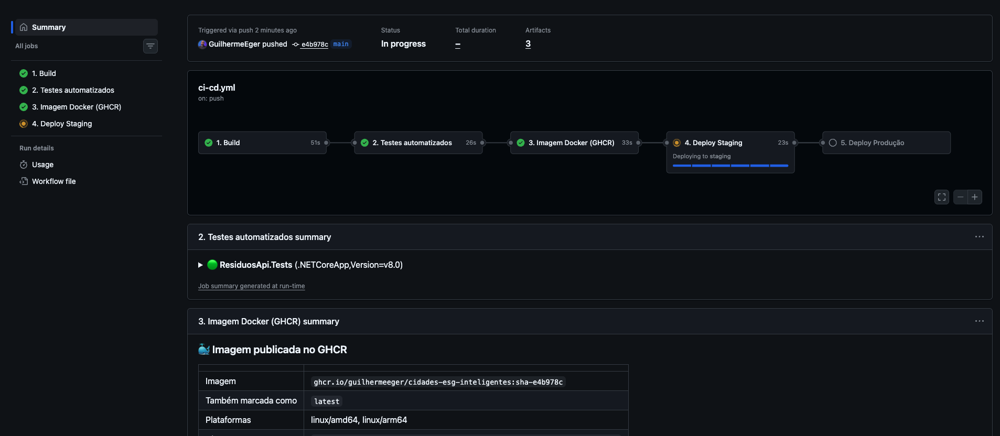

**Aprovação manual do deploy em produção (Review pending deployments → Approve and deploy)**

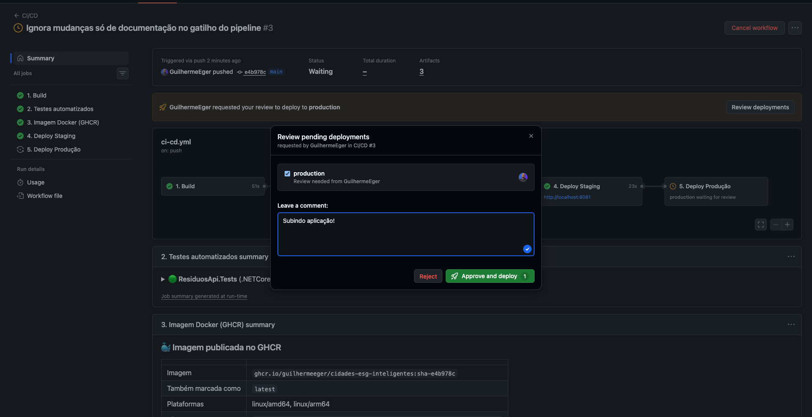

**Após a aprovação: deploy em produção em andamento**

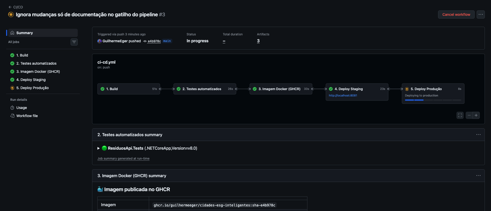

**Execução concluída: os 5 jobs verdes, com os links dos dois ambientes**

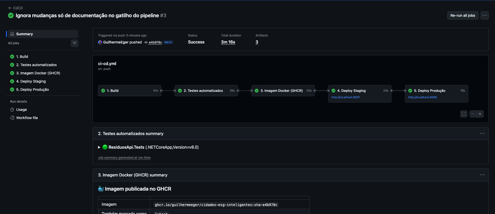

**Execução pública do pipeline: 5 jobs, aprovação registrada para production e artefatos gerados**

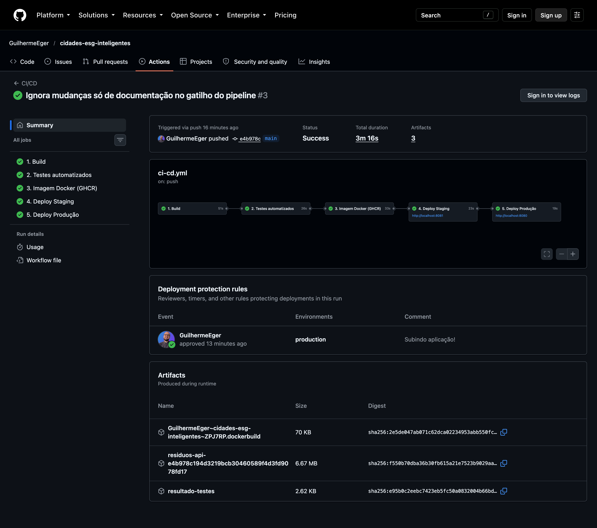

### 🧪 Build e testes

**Job 1 — Build: restore, compilação Release, publish e artefato**

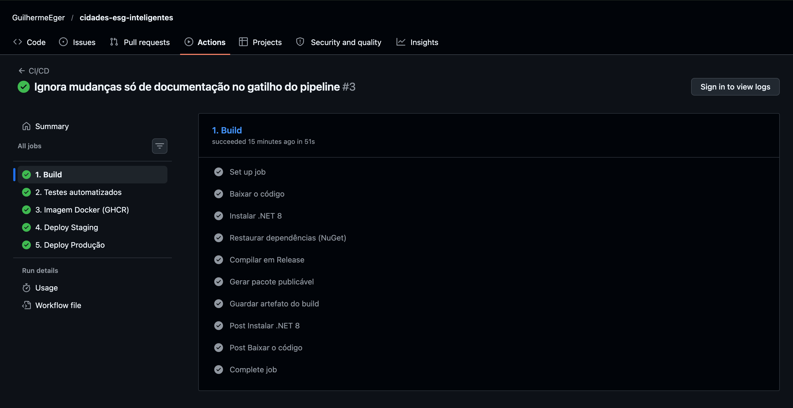

**Job 2 — Testes automatizados com xUnit**

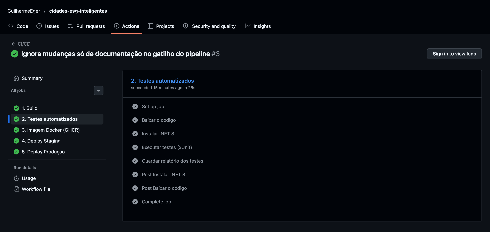

**Log do job de testes e relatório .trx baixado dos artefatos: 9 testes aprovados**

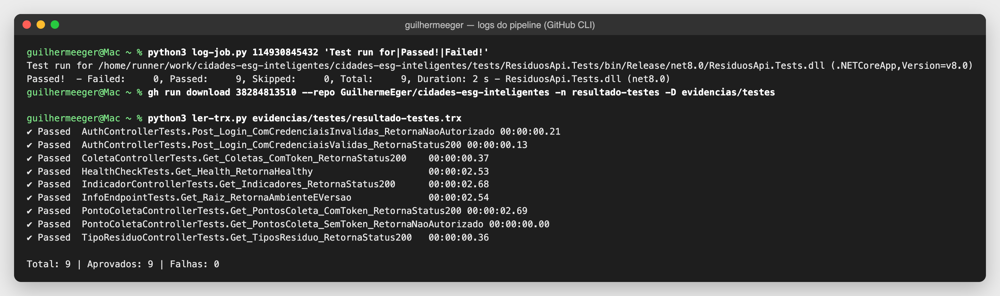

### 🐳 Imagem Docker

**Job 3 — QEMU + Buildx, login no GHCR, build e push da imagem**

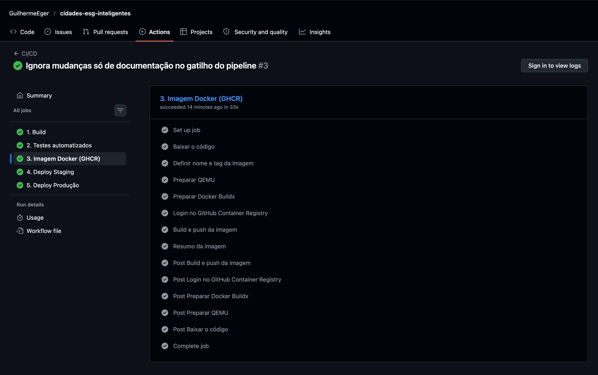

**Volumes, redes e imagem publicada pelo pipeline no servidor**

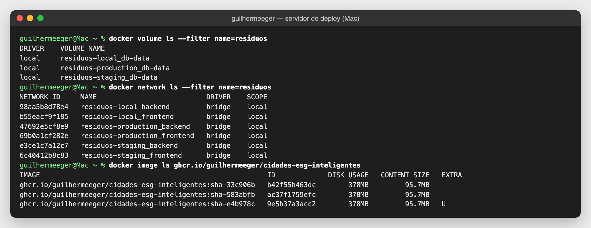

### 🚀 Deploy em staging e produção

**Job 4 — Deploy em staging: login no GHCR, Docker Compose e smoke test**

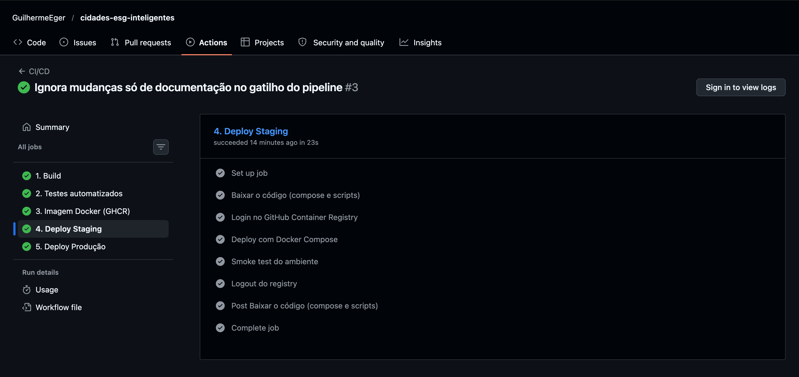

**Log do job de deploy em staging: runner self-hosted, Docker Compose e smoke test**


**Job 5 — Deploy em produção: mesmos passos, após aprovação manual**

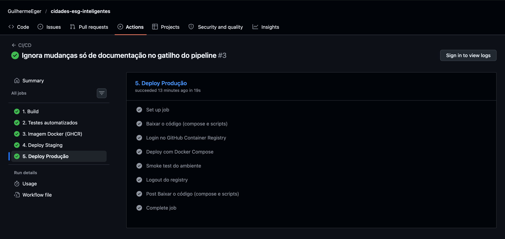

**Log do job de deploy em produção: mesma imagem, novo ambiente e smoke test**

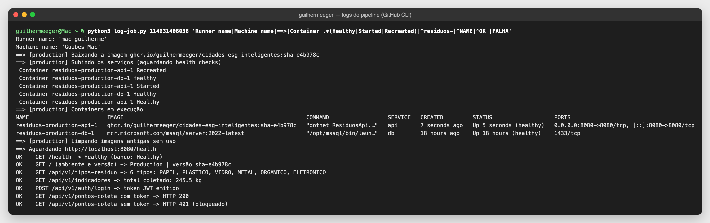

**Environments do GitHub (production com revisor obrigatório) e deploys registrados**

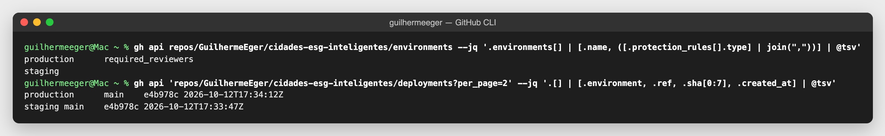

### 🟡 Staging funcionando — http://localhost:8081

**Staging (http://localhost:8081/swagger): Swagger habilitado**

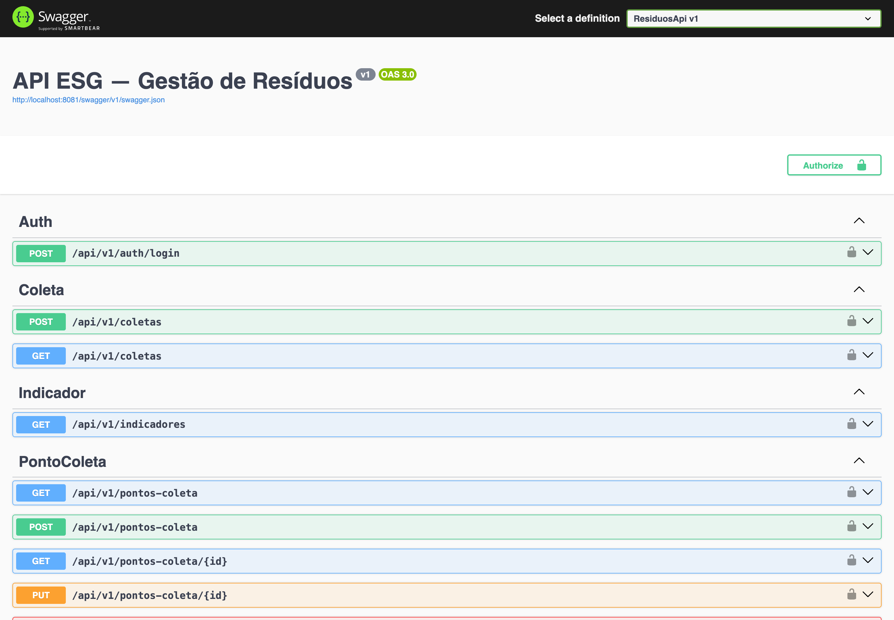

**Staging respondendo em http://localhost:8081: ambiente, versão, saúde e dados do banco**

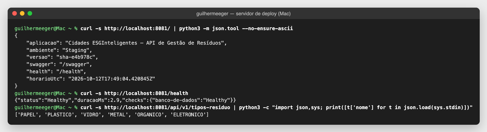

### 🟢 Produção funcionando — http://localhost:8080

**Produção respondendo em http://localhost:8080: mesma versão de staging, banco saudável, indicadores e Swagger bloqueado**

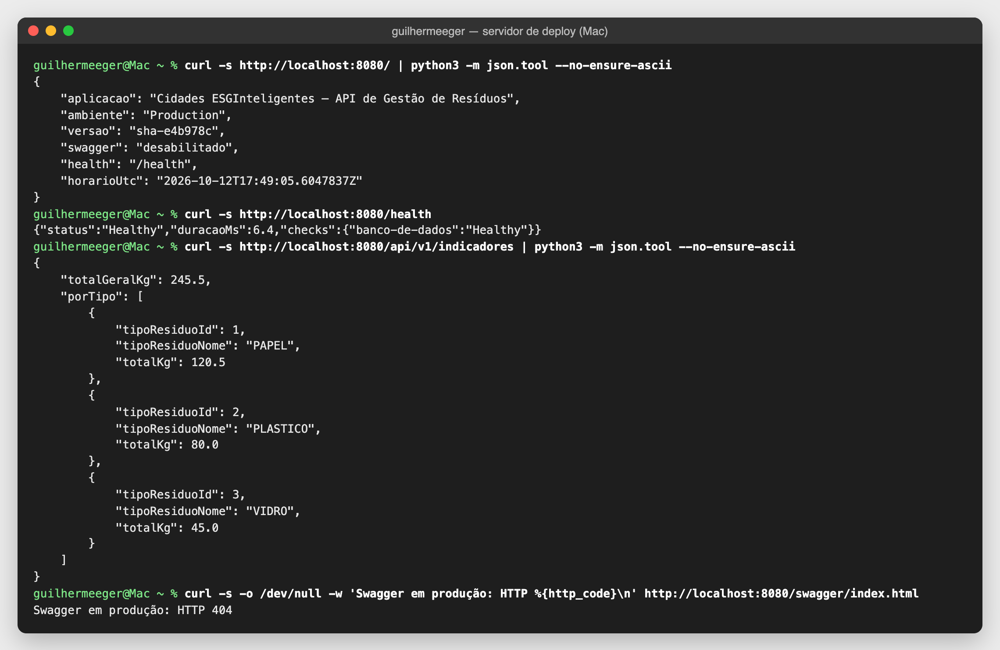

**Produção (http://localhost:8080/swagger): Swagger desligado por segurança (HTTP 404)**

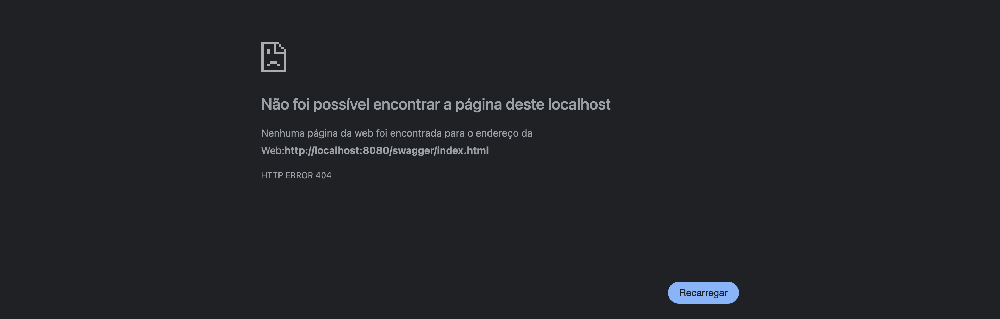

**Servidor de deploy: containers de staging e produção (API + banco), todos healthy**

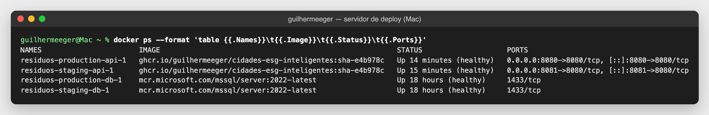

<!-- /PRINTS -->

---

## 🛠️ Tecnologias utilizadas

| Camada | Tecnologias |
|---|---|
| Linguagem / framework | C# 12, .NET 8, ASP.NET Core Web API |
| Dados | Entity Framework Core 8 (Code First + Migrations), SQL Server 2022 |
| API | JWT Bearer, Asp.Versioning, AutoMapper, Swagger/OpenAPI, Health Checks |
| Testes | xUnit, WebApplicationFactory, EF Core InMemory, GitHubActionsTestLogger |
| Containers | Docker (multi-stage, Buildx multi-arch), Docker Compose |
| CI/CD | GitHub Actions, GitHub Environments (staging/production), GitHub Container Registry (GHCR), self-hosted runner |
| Servidor de deploy | macOS + Colima (Docker Engine) |
| Qualidade | actionlint (workflow) e ShellCheck (scripts) |

### Endpoints (v1)

| Método | Rota | Auth | Descrição |
|---|---|---|---|
| GET | `/` | público | Ambiente e versão no ar |
| GET | `/health` | público | Saúde da API e do banco |
| POST | `/api/v1/auth/login` | público | Emite o token JWT |
| GET | `/api/v1/tipos-residuo` | público | Lista os 6 tipos de resíduo |
| GET | `/api/v1/indicadores` | público | Total geral (kg) + quebra por tipo |
| GET/POST | `/api/v1/pontos-coleta` | JWT | Lista paginada / cria ponto de coleta |
| GET/PUT/DELETE | `/api/v1/pontos-coleta/{id}` | JWT | Detalhe / atualiza / desativa |
| GET/POST | `/api/v1/coletas` | JWT | Lista com filtros / registra coleta |

### Estrutura do projeto

```
cidades-esg-inteligentes/
├── .github/workflows/ci-cd.yml   # pipeline CI/CD
├── Dockerfile                    # imagem da API (multi-stage)
├── docker-compose.yml            # API + SQL Server (volume, rede, env)
├── .env.example                  # variáveis para rodar localmente
├── deploy/
│   ├── staging.env               # configuração do ambiente de staging
│   ├── production.env            # configuração do ambiente de produção
│   ├── deploy.sh                 # deploy de um ambiente com Docker Compose
│   └── smoke-test.sh             # verificação pós-deploy
├── src/ResiduosApi/              # código-fonte da API
├── tests/ResiduosApi.Tests/      # testes automatizados (xUnit)
├── docs/                         # prints e coleção Insomnia
└── ResiduosApi.sln
```

---

## ✅ Checklist de entrega

| Item | OK |
|---|---|
| Projeto compactado em .ZIP com estrutura organizada | ☑ |
| Dockerfile funcional | ☑ |
| docker-compose.yml ou arquivos Kubernetes | ☑ |
| Pipeline com etapas de build, teste e deploy | ☑ |
| README.md com instruções e prints | ☑ |
| Documentação técnica com evidências (PDF ou PPT) | ☑ |
| Deploy realizado nos ambientes staging e produção | ☑ |
